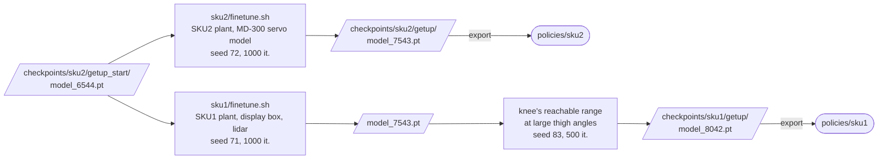
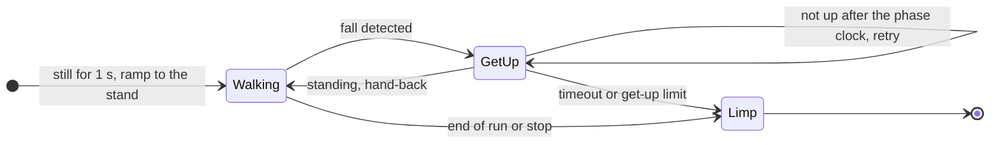

# The get-up

<p align="center">
  
  
</p>
<p align="center">
  
  
</p>

A get-up policy for the Mini Pupper v4 (top row the SKU2, bottom row the SKU1, in simulation): puts the robot back on
its feet from any fall pose, with or without the lidar on the hood. On the robot it is the add-on to the
[walker](../walker/README.md): on a detected fall it takes over from the walker, and it hands back once the robot
stands (on the SKU2 the runner on the Raspberry Pi switches between them, on the SKU1 the Mini Pupper v4 firmware on
the ESP32).

## Policies

| Robot | Policy | Inputs | Outputs | Network | Trained for |
|---|---|---|---|---|---|
| SKU2 | [`policies/sku2`](policies/sku2) | 45: one frame (gravity, gyro, joint positions and velocities, last action, the phase clock) | 12 joint targets about the stand (±90° abduction, ±180° hip and knee), through a target filter | 512-256-128, ELU, with an input normaliser | getting up from the back, either side, nose down, crouched, mid-fall and random poses, on flat and rough ground and the printed stairs, with a random load on the hood |
| SKU1 | [`policies/sku1`](policies/sku1) | the same | the same | the same | the same starts on the SKU1's plant, its display as a collision box, with and without the SKU1's lidar; then with the knee's reachable range at large thigh angles modelled in simulation |

Both run at 50 Hz. The phase clock φ runs from 0 to 1 over the first 4 s of a get-up and stays at 1; the policy sees
φ, sin 2πφ and cos 2πφ in place of the walker's command. Each policy folder holds
`policy.npz`, `config.json` and copies of the calibration and joint limits it was exported for; the runner reads the
calibration from there ([POLICY_CONTRACT.md](../../../docs/POLICY_CONTRACT.md)).

## How the pieces fit



Both fine-tunes resume the same starting checkpoint (actor, critic, optimiser and iteration) and keep its network and
settings; the smoothness loss and the target filter are trained under from the start.

## On the robot



- **SKU2:** the runner on the Raspberry Pi (`python3 -m mp4_rl.deploy.runner`, in `mp4_rl/deploy/`) runs the walker and
  the get-up together and switches between them as above; it sends servo targets over UART to the ESP32 running the
  Mini Pupper v4 firmware. The runner and the servo link need numpy and pyserial only. The
  [SKU2 robot guide](docs/ROBOT_SKU2.md) covers the firmware, deploying to the Pi (`tools/deploy.sh`), the checks before a
  run, launching, stopping, safety and what was measured.
- **SKU1:** both policies run on the ESP32 with the Mini Pupper v4 firmware, which detects the fall and switches between
  them: the [SKU1 robot guide](docs/ROBOT_SKU1.md).

## Quick start

Run from the repository root after the install ([INSTALL.md](../../../docs/INSTALL.md)); evaluation and training need
the `gpu` install.

```sh
# Check the shipped policy the way the robot does (CPU)
.venv/bin/python -m mp4_rl.deploy.runner check --policy mp4_rl/skills/getup/policies/sku2

# Evaluate in simulation: the get-up from every start, and walk, shove, fall, get up, walk for 60 s
sh mp4_rl/skills/getup/eval/sku2.sh runs/eval_getup gflat_s21 seq_s21
.venv/bin/python mp4_rl/skills/getup/eval/score.py runs/eval_getup

# Fine-tune from the starting checkpoint and export the result
sh mp4_rl/skills/getup/recipes/sku2/finetune.sh
.venv/bin/python -m mp4_rl.common.export runs/getup_finetune/<run>/model_<k>.pt runs/exports/getup

# Put both policies on the SKU2's Raspberry Pi (ubuntu@PI: the Pi's user and address)
tools/deploy.sh ubuntu@PI walk
```

## The recipes

| Robot | Recipe | Parent | Seed | Iterations | Output |
|---|---|---|---|---|---|
| SKU2 | `recipes/sku2/finetune.sh` | `checkpoints/sku2/getup_start/model_6544.pt` | 72 | 1000 | `runs/getup_finetune/` |
| SKU1 | `recipes/sku1/finetune.sh` | `checkpoints/sku2/getup_start/model_6544.pt` | 71 | 1000 | `runs/getup_sku1/` |

`checkpoints/sku2/getup/model_7543.pt` is the SKU2 recipe's last checkpoint, and `policies/sku2` was exported from it.
`checkpoints/sku1/getup/model_8042.pt`, exported as `policies/sku1`, is 500 iterations (seed 83) from the SKU1 recipe's
last checkpoint, model_7543, trained with the knee's reachable range at large thigh angles modelled in simulation, an
option not in this repository yet. In simulation (seeds 23 and 24) it gets up from every start in at least 99.8 % of
the robots, on flat ground and with the lidar, also at 16 bits with 20 ms of added delay.

Each script takes `[SEED] [PARENT] [ITERS]`, and `ENVS`, `OUT` and `EXTRA` from the environment; its header lists every
setting. On an RTX 5080 a fine-tune takes 2.5-2.7 h.
These are the settings of the shipped policies, not a promise of the same numbers: a run's result depends on its seed and
the machine.

**SKU2.** The plant: the SKU2 model with its measured joint limits and weighed masses (630.5 g), the MD-300 servo model on
a 3S supply (10.5-12.6 V), from mini_pupper_4_sim. Settings:

| Setting | Value |
|---|---|
| Starts | crouched, partly fallen, on a side, nose down, on the back, random joints (5, 5, 25, 15, 40, 10 %); a fifth from a mid-fall |
| Episode | 8 s; ends once the robot is up |
| Band | 90° on abductions, 180° on hips and knees, about the stand, inside the measured joint limits |
| Phase clock | 4 s |
| Target filter | α 0.75 (see [POLICY_CONTRACT.md](../../../docs/POLICY_CONTRACT.md#target-filter)) |
| Costs | action rate −0.1, kept whole while tilted; joint velocity −5e-4 |
| Terrain | half the columns flat, half rough ground (relief on a 2 cm grid, slopes, boxes) and the printed four- and eight-step stairs |
| Load on the hood | a cylinder drawn per robot (0-40 mm high, 0-70 g) |
| Exploration | the checkpoint's std (0.03), clamped to 0.06-0.3 when sampling; no entropy bonus |
| Learning rate | starts at 1e-5, adaptive, at most 5e-5; the critic warmed up for 30 iterations |

**SKU1.** The SKU2 fine-tune's settings, except:

- the SKU1 (`--robot sku1`): its model, calibration, joint limits traced on the robot and weighed masses (413.4 g);
- its display as a collision box on the body (`--display-collision`);
- instead of the random load, the SKU1's lidar (35 mm high, 47.2 g with its mount, its axis drawn 20 mm behind to 10 mm
  in front of the base origin and 10 mm either side) on half the robots;
- the whole robot's centre of mass drawn 61-70 mm above the floor.

### The trainer

`python -m mp4_rl.skills.getup.train` trains the get-up; with `--resume` it fine-tunes a checkpoint (actor, critic,
optimiser and iteration come from it). **The smoothness loss** (the trainer's `--caps-*` options, after CAPS,
Conditioning for Action Policy Smoothness) is added to the PPO update (`mp4_rl/common/algorithms.py`), on the actor's
mean, with weights 2 (temporal) and 40 (spatial):

```
temporal  mean |mu(o_t+1) - mu(o_t)|^2      over consecutive steps of one robot, not across a reset
spatial   mean |mu(o) - mu(o + eps)|^2      eps ~ N(0, 0.05^2), in the normalised input
```

With the target filter it removes fast target reversals while the robot is in the air. Both have to be trained under: a
filter added to a finished policy breaks it.

**A quick check of a recipe** (fewer robots and a few iterations, in its own output folder; an empty positional argument
keeps its default):

```sh
ENVS=64 OUT=runs/quick sh mp4_rl/skills/getup/recipes/sku2/finetune.sh "" "" 5
```

A run saves `model_<k>.pt` where k counts on from the parent's iteration: every 50 iterations (k a multiple of 50) and
at the end, k = the parent's iteration + ITERS - 1 (`model_6548.pt` from `model_6544.pt` with 5 iterations). Such a
checkpoint exports and passes `runner check` like any other; it is not a trained policy.

## Results on the robot

Each take is one run. Get-up times come from the runner's log (SKU2) or the firmware's get-up log (SKU1).

### SKU2

With `policies/sku2` and the walker's `policies/sku2`, run by the runner on the Raspberry Pi:

| | Takes | Result |
|---|---|---|
| Get-ups from placed fall poses: back, left side, right side, nose down; then back and right side with the lidar | one per pose: 4, and 2 with the lidar | every one up, standing in 1.5-1.7 s |
| Shoves by hand: standing (a 40 s run), and walking at 0.10 m/s (a 15 s run) | 2 runs, 6 shoves | every get-up the run's time allowed (5): up again in 1.4-1.7 s, walking on in the walking run |

### SKU1

With the previous get-up (model_7543) and the walker's `policies/sku1`, on the robot's ESP32; the current
`policies/sku1` has not run on the robot yet:

| | Takes | Result |
|---|---|---|
| Get-ups from placed fall poses: left side, right side, back, nose down | one per pose: 4 | every one up: right side 1.5 s, nose down 1.5 s, back 1.7 s, left side 3.9 s |
| Shoves by hand until it fell: standing, and walking forward at 0.10 m/s | 18 falls in 2 runs: 8 standing, 10 walking | 18 of 18 back up (standing: 1.5-1.8 s, one 6.6 s), and walking again in the walking run |

The lidar cases, rough ground and the printed stairs were evaluated in simulation.

## Evaluation

```sh
.venv/bin/python -m mp4_rl.common.export runs/getup_finetune/<run>/model_<k>.pt runs/exports/getup
.venv/bin/python -m mp4_rl.deploy.runner check --policy runs/exports/getup

GETUP=runs/exports/getup sh mp4_rl/skills/getup/eval/sku2.sh runs/eval_getup gflat_s21 glidar_s21 seq_s21
.venv/bin/python mp4_rl/skills/getup/eval/score.py runs/eval_getup

# Videos: watch them, the numbers don't show everything
VIDEOS=1 GETUP=runs/exports/getup sh mp4_rl/skills/getup/eval/sku2.sh runs/eval_getup vid_back
```

`export` takes the robot, the joint limits, the stance offset, the target filter and the servo model from the run's
options; `--help` lists the overrides. `eval/sku2.sh OUT [NAME ...]` runs the get-up's evaluations on the SKU2's plant
(by default for `policies/sku2`, and the walker's `policies/sku2` in the sequence; `GETUP` and `WALKER` select others),
one JSON per evaluation in `OUT`; the names select some of them:

| Name | Evaluation |
|---|---|
| `gflat_s21` ... `gflat_s24` | 512 robots from each start (left, right, back, nose down, mid-fall, random) on flat ground, seeds 21-24 |
| `glidar_s21` ... `glidar_s24` | the same with the lidar on the hood |
| `seq_s21` ... `seq_s24` | the sequence with the walker: walk, kicks of 0.5-1.5 m/s every 2-4 s, fall, get up, walk (256 robots, 60 s) |
| `gterr_s21`, `gterr_s23` | every start on rough ground (reliefs, slopes, boxes; 1024 robots) |
| `gstairs_s21`, `gstairs_s23` | every start on the printed four- and eight-step stairs (1024 robots) |
| `vid_back` | a short video of a get-up from the back (with `VIDEOS=1`) |

**Scoring.** `eval/score.py OUT` prints the tables: success per start, without and with the lidar, per seed; in the
sequence the share walking again within 8 s of a fall, the robots that never got up, and the times; get-ups on rough
ground and the stairs. A result depends on the seed and varies by a few points between
runs on a GPU. On an RTX 5080 one evaluation takes a few minutes (a get-up from every start on flat ground about 2-7
min); the sequence and the terrain evaluations run longer, and the whole script a few hours. `QUICK=1` runs each with an
eighth of its robots, as a quick check rather than a result (give it its own `OUT`: a finished evaluation's JSON is not
run again):

```sh
QUICK=1 sh mp4_rl/skills/getup/eval/sku2.sh runs/eval_getup_quick gflat_s21
```

**On the SKU1:** `eval/sku1.sh` runs the same evaluations on the SKU1's plant, by default for `policies/sku1` (and the
walker's `policies/sku1` in the sequence); `GETUP` and `WALKER` select others exported for the SKU1 (`WALKER=` skips the
sequence). The starting checkpoint exported for the SKU1 (the network as it is, the decoder's clamps from the SKU1's
calibration and joint limits) is the baseline the SKU1 fine-tune is compared with:

```sh
sh mp4_rl/skills/getup/eval/sku1.sh runs/eval_getup_sku1 gflat_s21 glidar_s21 seq_s21
.venv/bin/python mp4_rl/skills/getup/eval/score.py runs/eval_getup_sku1

.venv/bin/python -m mp4_rl.common.export mp4_rl/skills/getup/checkpoints/sku2/getup_start/model_6544.pt \
    runs/exports/getup_start_sku1 --robot sku1 --limits
GETUP=runs/exports/getup_start_sku1 sh mp4_rl/skills/getup/eval/sku1.sh runs/eval_getup_start_sku1 gflat_s21 glidar_s21
```

`--limits` puts the measured joint limits in the decoder's clamps. The starting checkpoint was trained without them (its
`config.json` has no `limits` option), so its export needs it; an export of a fine-tuned run (trained with the limits)
or of a policy folder (`--from-policy`) takes it from the run or the folder. The SKU1 recipe trains with the display as
a collision box; a policy exported from such a run has it in its metadata, and the evaluators use it. To evaluate
another policy with it, add `--display-collision` to the evaluator's command line.

## Checking a re-export

`export --from-policy policies/sku2 OUT` gives the same network arrays and metadata (its `source_policy_sha256` records
the folder's `policy.npz`) and byte-identical copies of `config.json`, the calibration and the joint limits. An export
of the final checkpoint (`checkpoints/sku2/getup/model_7543.pt`) gives the same network arrays and metadata except
`source_policy_sha256`; the `policy.npz` bytes and `config.json` differ, because the shipped folder is itself a
`--from-policy` copy: the file that ran on the robot, re-exported for the published calibration file with its network
unchanged. For the SKU1, `--from-policy policies/sku1` gives the same arrays and metadata (plus
`source_policy_sha256`) and byte-identical copies of the other files, and an export of
`checkpoints/sku1/getup/model_8042.pt` gives the shipped `policy.npz` byte for byte (its `config.json` then holds only the
checkpoint's options). `tests/cpu/test_policies.py` checks all of them against the shipped folders:

```sh
CUDA_VISIBLE_DEVICES="" .venv/bin/python -m pytest tests/cpu/test_policies.py -k export
```

## What is where

```
README.md          this page
media/             the animations above
docs/              ROBOT_SKU2.md (the runner on the Raspberry Pi), ROBOT_SKU1.md (the firmware on the ESP32)
task.py            the task: starts, the phase clock, rewards, costs, terrain, the load on the hood
train.py           the trainer (python -m mp4_rl.skills.getup.train)
eval/              getup_eval.py, sequence.py (with the walker), motion_meter.py, reach.py; sku2.sh and sku1.sh run
                   them, score.py prints the tables
data/              sku2_proven_reach.json: how far each hip has moved towards the body's middle on the robot
recipes/sku2/, recipes/sku1/          finetune.sh
policies/sku2/, policies/sku1/        the exported policies
checkpoints/sku2/  getup_start/ (where both recipes start) and getup/ (the SKU2 recipe's last checkpoint)
checkpoints/sku1/  getup/ (the SKU1 recipe's last checkpoint)
```

The runner that runs it on the SKU2 with the walker, and the serial link, are shared and live in `mp4_rl/deploy/`; the
rest of the shared code is in `mp4_rl/common/`.
