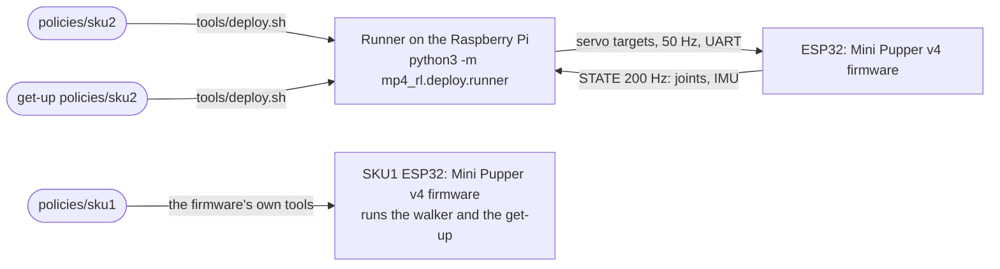

# The walker

<p align="center">
  
  
  
</p>
<p align="center">
  
  
  
</p>

A walking policy for the Mini Pupper v4 (top row the SKU2, bottom row the SKU1, in simulation): walks in every
direction, turns in place and rides out shoves; in simulation it also climbs stairs and walks on rough ground. 
It runs on its own, or with the [get-up](../getup/README.md), which takes over after a fall.

## Policies

| Robot | Policy | Inputs | Outputs | Network | Trained for |
|---|---|---|---|---|---|
| SKU2 | [`policies/sku2`](policies/sku2) | 450: 10 frames × 45 (gravity, gyro, joint positions and velocities, last action, command) | 12 joint targets about the stand (±20° abduction, ±60° hip and knee) | 128-128-64, ELU | walking up to 0.20 m/s in every direction, turning in place up to 2.0 rad/s, kicks up to 1.5 m/s, rough ground and stairs, with and without the lidar |
| SKU1 | [`policies/sku1`](policies/sku1) | the same | the same | the same | the same commands and kicks on the SKU1's plant, rough ground, with and without the SKU1's lidar |

Both run at 50 Hz with the abductions' stand 12° further out than the calibrated stand (a wider stance is what makes the
walker ride out shoves; the policy's metadata carries the offset and the runner applies it). The command is
`[vx, vy, wz]`; with no turn commanded, a heading loop holds the direction the robot faced at the start. Each policy
folder holds `policy.npz` (the network and its metadata, [POLICY_CONTRACT.md](../../../docs/POLICY_CONTRACT.md)),
`config.json` (the training run's options) and copies of the calibration and joint limits it was exported for.

## How the pieces fit

```mermaid
flowchart LR
  start[/"checkpoints/sku2/walker_start/<br/>model_6297.pt"/] --> step1["step1.sh<br/>wider commands, kicks<br/>seed 71, 1000 it."]
  step1 --> step2["step2.sh<br/>full range, heading hold<br/>seed 81, 1500 it."]
  step2 --> step3["step3.sh<br/>more turning in place<br/>seed 91, 1000 it."]
  step3 --> step4["step4.sh<br/>partial turns pay<br/>seed 101, 1000 it."]
  step4 --> ckpt2[/"checkpoints/sku2/walker/<br/>model_10793.pt"/]
  ckpt2 -->|export| pol2(["policies/sku2"])
  ckpt2 --> ft1["sku1/finetune.sh<br/>SKU1 plant, rough ground<br/>seed 210, 1000 it."]
  pol2 -->|"export --robot sku1:<br/>the anchor"| ft1
  ft1 --> ckpt1[/"checkpoints/sku1/walker/<br/>model_11792.pt"/]
  ckpt1 -->|export| pol1(["policies/sku1"])
```



Every step resumes its parent checkpoint and is anchored to the walker it started from (below): it keeps its gait
where it already walked and learns the rest.

## On the robot



On the SKU2 the runner on the Raspberry Pi runs the walker and switches to the get-up on a detected fall:
[the SKU2 robot guide](../getup/docs/ROBOT_SKU2.md). On the SKU1 both policies run on the ESP32 with the Mini Pupper v4
firmware: [the SKU1 robot guide](../getup/docs/ROBOT_SKU1.md).

## Quick start

Run from the repository root after the install ([INSTALL.md](../../../docs/INSTALL.md)); evaluation and training need
the `gpu` install.

```sh
# Check the shipped policy the way the robot does (CPU)
.venv/bin/python -m mp4_rl.deploy.runner check --policy mp4_rl/skills/walker/policies/sku2

# Evaluate it in simulation: the omni command grid and the kicks, then the tables
sh mp4_rl/skills/walker/eval/sku2.sh runs/eval_walker omni_s21 push_s21
.venv/bin/python mp4_rl/skills/walker/eval/score.py runs/eval_walker

# Fine-tune (step 1 of the SKU2 recipe) and export the result
sh mp4_rl/skills/walker/recipes/sku2/step1.sh
.venv/bin/python -m mp4_rl.common.export runs/walker_step1/<run>/model_<k>.pt runs/exports/walker
```

## The recipes

### SKU2

Fine-tuned in four steps on the SKU2's simulated plant from `checkpoints/sku2/walker_start/model_6297.pt`. The plant: the
SKU2 model with its measured joint limits and weighed masses (630.5 g), the MD-300 servo model on a 3S supply
(10.5-12.6 V) with the winding resistance drawn from 0.95-1.15 × its fitted value; all from mini_pupper_4_sim. Each
script's header lists every setting.

```sh
sh mp4_rl/skills/walker/recipes/sku2/step1.sh      # from checkpoints/sku2/walker_start/model_6297.pt
sh mp4_rl/skills/walker/recipes/sku2/step2.sh      # from the last checkpoint of the newest step-1 run, and so on to step4.sh
```

| Recipe | Parent | Seed | Iterations | What it changes |
|---|---|---|---|---|
| `step1.sh` | `walker_start/model_6297.pt` | 71 | 1000 | Widens the commands over the first 300 iterations, from 0.12 m/s and 1.0 rad/s to 0.20 m/s and 2.0 rad/s turning in place; kicks up to 1.5 m/s from iteration 300 |
| `step2.sh` | step 1's last checkpoint | 81 | 1500 | The full command range from the start, 40 % of the walks and turns drawn from the fast end, and a reward for holding the heading |
| `step3.sh` | step 2's last checkpoint | 91 | 1000 | Turning in place weighted up to 40 % of the commands, fast turns drawn from 1.0-2.0 rad/s |
| `step4.sh` | step 3's last checkpoint | 101 | 1000 | Pays for partial turns, so fast turns in either direction keep turning; a stronger heading hold |

`checkpoints/sku2/walker/model_10793.pt` is step 4's last checkpoint: `policies/sku2` was exported from it. Each script
takes `[SEED] [PARENT] [ITERS]`, and `ENVS`, `OUT` and `EXTRA` from the environment; its output goes to
`runs/walker_step<N>/`. On an RTX 5080 (16 GB) running three runs at a time, 1000 iterations take about 2-3 h.

### SKU1

`recipes/sku1/finetune.sh` continues the SKU2's fine-tuned walker on the SKU1's simulated plant with step 4's settings:

| Recipe | Parent | Seed | Iterations |
|---|---|---|---|
| `sku1/finetune.sh` | `checkpoints/sku2/walker/model_10793.pt` | 210 | 1000 |

What it changes:

- the SKU1 (`--robot sku1`): its model, calibration, joint limits traced on the robot and weighed masses (413.4 g);
- rough ground (relief, slopes, steps and boxes) instead of the narrow stairs;
- the get-up's self-collision on the walker's plant;
- the SKU1's lidar (47.2 g with its mount, its axis drawn 20 mm behind to 10 mm in front of the base origin and 10 mm
  either side) on half the robots;
- the whole robot's centre of mass drawn 61-70 mm above the floor;
- anchored to the shipped SKU2 walker exported for the SKU1, over the whole command range (up to 0.20 m/s and 2.0 rad/s
  turning in place, 1.0 rad/s while walking) and with weight 10 instead of 5.

`checkpoints/sku1/walker/model_11792.pt` is its last checkpoint: `policies/sku1` was exported from it. The run that made
it used the walk-mode joint limits estimated before the SKU1's legs were traced (the SKU2's measured ranges at the
SKU1's calibration); the recipe uses the traced limits, which the policy is exported for. Other seeds of the recipe came
out weaker in simulation than this run: evaluate a new run before using it. The anchor is a policy folder the script
makes before training, unless `ANCHOR` names another:

```sh
.venv/bin/python -m mp4_rl.common.export --from-policy mp4_rl/skills/walker/policies/sku2 runs/walker_sku1/anchor_sku1 \
    --robot sku1
```

The export keeps the network and takes the decoder's clamps from the SKU1's calibration and joint limits. The script
takes `[SEED] [PARENT] [ITERS]` and `ENVS`, `OUT`, `ANCHOR`, `EXTRA` from the environment; output in `runs/walker_sku1/`.

These are the settings of the shipped policies, not a promise of the same numbers: a run's result depends on its seed and
the machine.

### The trainer

`python -m mp4_rl.skills.walker.train` resumes a walker checkpoint (its run's `config.json` beside it); its docstring
lists every option. Every step:

- **is anchored to the starting walker** (`mp4_rl/common/anchor_ppo.py`; the anchor is the policy the fine-tune is held
  close to): PPO plus 5 × the mean squared difference between the actor's mean and that of the starting checkpoint, only
  on commands inside the range that walker was trained on (0.12 m/s, 1.0 rad/s turning in place, 0.6 rad/s while
  walking) and not within 2 s of a kick;
- trains on rough ground and stairs, narrow flights with 25-45 mm risers among them (`terrain.py`), with foot clearance,
  stumble, progress and overspeed terms (`task.py`);
- kicks the robots: 0-0.6 m/s every 4-8 s, and 0.6-1.5 m/s every 8-15 s;
- puts the lidar on half the robots;
- holds the abductions' stand 12° further out than the calibrated stand (`--stand-offset-abd 12`).

**A quick check of a recipe** (fewer robots and a few iterations, in its own output folder; an empty positional argument
keeps its default):

```sh
ENVS=64 OUT=runs/quick sh mp4_rl/skills/walker/recipes/sku2/step1.sh "" "" 5
```

A run saves `model_<k>.pt` where k counts on from the parent's iteration: every 50 iterations (k a multiple of 50), at
300 iterations after the parent and at the end, k = the parent's iteration + ITERS - 1 (`model_6301.pt` from
`model_6297.pt` with 5 iterations). Such a checkpoint exports and passes `runner check` like any other; it is not a
trained policy. The next step looks for its parent in `runs/walker_step<N>/`, so a run in another `OUT` doesn't become
one.

## Results on the robot

Each take is one run; speeds come from the distance on a tape measure over the run's time, turn rates from the gyro
(SKU2) or the angle turned over the run's time (SKU1), and the simulated figures from the omni evaluation on each
robot's plant (`omni_s21`).

### SKU2

With `policies/sku2`, run by the runner on the Raspberry Pi:

| | Takes | Result |
|---|---|---|
| Walking forward (0.10, 0.20 m/s), backward (0.10) and sideways (0.10, 0.20) | 7 | 0.69-0.91 × the speed simulation predicts for the same command (sideways the slowest), no falls |
| Turning in place at ±0.5, +1.0 and ±2.0 rad/s | 5 | 0.81-0.90 × the simulated turn rate; up to 1.71 rad/s and -1.83 rad/s at a ±2.0 rad/s command |
| Walking at 0.10 m/s while turning at 0.5 rad/s | 1 | about two thirds of the simulated turn (0.67 ×) |
| Shoves while walking at 0.10 m/s, with the get-up | 1 run | walking on after every get-up ([the get-up](../getup/README.md#results-on-the-robot)) |

### SKU1

With `policies/sku1`, on the robot's ESP32:

| Command | Robot | Simulation | Robot / simulation |
|---|---|---|---|
| Forward 0.10 m/s | 0.076 m/s | 0.109 m/s | 0.70 |
| Forward 0.20 m/s | 0.133 m/s | 0.186 m/s | 0.72 |
| Backward 0.10 m/s | 0.075 m/s | 0.099 m/s | 0.76 |
| Left 0.10 m/s | 0.070 m/s | 0.109 m/s | 0.64 |
| Right 0.12 m/s | 0.102 m/s | 0.120 m/s | 0.85 |
| Turn +1.0 rad/s | 0.79 rad/s | 1.22 rad/s | 0.64 |
| Turn -1.0 rad/s | -0.98 rad/s | -1.25 rad/s | 0.79 |
| Turn +2.0 rad/s | 1.36 rad/s | 2.13 rad/s | 0.64 |
| Forward 0.10 m/s, turn -0.5 rad/s | 0.081 m/s along its arc, turn -0.25 rad/s | 0.112 m/s, turn -0.41 rad/s | 0.73 (speed), 0.61 (turn) |

One take per command, no falls. The printed stairs, rough ground and the lidar were evaluated in simulation.

## Evaluation

```sh
.venv/bin/python -m mp4_rl.common.export runs/walker_step4/<run>/model_<k>.pt runs/exports/walker
.venv/bin/python -m mp4_rl.deploy.runner check --policy runs/exports/walker

WALKER=runs/exports/walker sh mp4_rl/skills/walker/eval/sku2.sh runs/eval_walker omni_s21 push_s21
.venv/bin/python mp4_rl/skills/walker/eval/score.py runs/eval_walker
```

`eval/sku2.sh OUT [NAME ...]` runs the walker's evaluations on the SKU2's plant (by default for `policies/sku2`;
`WALKER` selects another), one JSON per evaluation in `OUT`; the names select some of them:

| Name | Evaluation |
|---|---|
| `omni_s21`, `omni_s22` | the omni command grid (walks in every direction, turns, walks while turning; 24 robots per command), seeds 21 and 22 |
| `omni_lidar_s21`, `omni_lidar_s22` | the same with the lidar on the hood |
| `push_s21`, `push_s22` | kicks while standing and while walking |
| `classic_s21`, `classic_s22` | the firmware's classic gait on the omni grid, the baseline |
| `wrough_s21`, `wrough_lidar_s21` | rough ground, without and with the lidar |
| `wstairs_s21`, `wstairs_lidar_s21` | the printed four-step stairs, without and with the lidar |
| `vid_side`, `vid_front`, `vid_stairs` | short videos (with `VIDEOS=1`) |

**Scoring.** `eval/score.py OUT` prints the tables: the speed on each command against the classic gait, falls per kick
speed, success on rough ground and the stairs. A result depends on the seed and varies by a few points between runs on
a GPU. On an RTX 5080 one evaluation takes a few minutes (an omni grid about 1-2 min); the kick grid and the terrain
evaluations run longer, and the whole script a few hours. `QUICK=1` runs each evaluation with an eighth of its robots,
as a quick check rather than a result (give it its own `OUT`: a finished evaluation's JSON is not run again):

```sh
QUICK=1 sh mp4_rl/skills/walker/eval/sku2.sh runs/eval_walker_quick omni_s21 push_s21
```

**On the SKU1:** `eval/sku1.sh` runs the same evaluations on the SKU1's plant, by default for `policies/sku1`; `WALKER`
selects another walker exported for the SKU1, for example the SKU2 walker as it is:

```sh
sh mp4_rl/skills/walker/eval/sku1.sh runs/eval_walker_sku1 omni_s21 push_s21
.venv/bin/python mp4_rl/skills/walker/eval/score.py runs/eval_walker_sku1

.venv/bin/python -m mp4_rl.common.export --from-policy mp4_rl/skills/walker/policies/sku2 runs/exports/walker_sku1 --robot sku1
WALKER=runs/exports/walker_sku1 sh mp4_rl/skills/walker/eval/sku1.sh runs/eval_walker_sku2_on_sku1 omni_s21
```

The export takes the robot from the run (`--robot` exports for another one), and an evaluator takes the robot, legs and
joint limits from the policy's metadata.

## Checking a re-export

`export --from-policy policies/sku2 OUT` gives the same network arrays and metadata (its `source_policy_sha256` records
the folder's `policy.npz`) and byte-identical copies of `config.json`, the calibration and the joint limits. An export
of the final checkpoint (`checkpoints/sku2/walker/model_10793.pt`) gives the same network arrays and metadata except
`source_policy_sha256`; the `policy.npz` bytes and `config.json` differ, because the shipped folder is itself a
`--from-policy` copy: the file that ran on the robot, re-exported for the published calibration file with its network
unchanged. For the SKU1, `--from-policy policies/sku1` gives the same arrays and metadata (plus
`source_policy_sha256`) and byte-identical copies of the other files, and an export of
`checkpoints/sku1/walker/model_11792.pt` gives the shipped `policy.npz` byte for byte (its `config.json` then holds only
the checkpoint's options). `tests/cpu/test_policies.py` checks all of them against the shipped folders:

```sh
CUDA_VISIBLE_DEVICES="" .venv/bin/python -m pytest tests/cpu/test_policies.py -k export
```

## What is where

```
README.md          this page
media/             the animations above
task.py            the task: commands, rewards (tracking, heading hold, clearance, stumble, progress), kicks, curricula
terrain.py         the training terrain: rough ground and narrow stair flights
train.py           the trainer (python -m mp4_rl.skills.walker.train)
eval/              omni.py, push.py, terrain.py, gait_metrics.py; sku2.sh and sku1.sh run them, score.py prints the tables
recipes/sku2/      step1.sh to step4.sh
recipes/sku1/      finetune.sh
policies/sku2/, policies/sku1/        the exported policies
checkpoints/sku2/  walker_start/ (where the recipe starts) and walker/ (its last checkpoint)
checkpoints/sku1/  walker/ (the SKU1 recipe's last checkpoint)
```

The shared code it uses is in `mp4_rl/common/` (the policy interface, export, PPO with the anchor, the simulation
environment on mp4_sim's scene, the classic gait baseline) and the runner in `mp4_rl/deploy/`.
